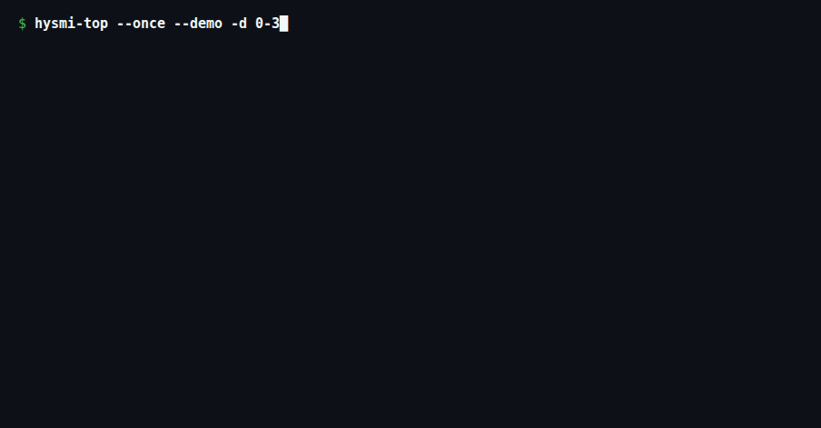

<div align="center">

# hysmi-top

**Zero-dependency Braille curve terminal monitor for Hygon DCU (`hy-smi`) accelerators.**

[](https://github.com/mcocdaa/hysmi-top/actions/workflows/ci.yml)
[](https://github.com/mcocdaa/hysmi-top/releases)
[](https://www.python.org/downloads/)
[](LICENSE)

[English](README.md) · [简体中文](README_CN.md)



</div>

## ✨ Highlights

- **Zero External Dependencies** — Built solely on Python standard library (`curses`) and direct Linux kernel `sysfs` (`/sys/class/drm/cardN/device/`) telemetry reads with zero subprocess polling overhead.
- **Smooth Braille Dual-Curve Overlay** — Plots real-time `─HCU%` (green) and `─VRAM%` (magenta) scrolling curves on the same chart, automatically merging overlapping points into a single bold-blue `mix` dot.
- **Adaptive Multi-Column Pod Layout** — Dynamically scales chart height and column count (`1..N` pods per row with proportional spacing) to fit any terminal size on the fly.
- **Hardware-Free `--demo` Mode** — Preview realistic 8-card Hygon DCU workload patterns (`sine`, `cosine`, `square`, `sawtooth`, `burst`, and overlap modes) anywhere without physical DCU hardware.
- **Scriptable Telemetry Snapshots** — Export one-shot text (`--once`) or structured JSON (`--once --json`, including active `hy-smi --showpids` processes) for CI pipelines and cluster monitoring scripts.

## 🚀 Quick Start

**Run instantly without installing (`uvx`):**

```bash
uvx --from git+https://github.com/mcocdaa/hysmi-top.git hysmi-top
uvx --from git+https://github.com/mcocdaa/hysmi-top.git hysmi-top --demo
```

**Install globally (`uv` / `pip`):**

```bash
uv tool install git+https://github.com/mcocdaa/hysmi-top.git
# or: pip install git+https://github.com/mcocdaa/hysmi-top.git
```

**Offline install for air-gapped DCU clusters:**

Download `hysmi_top-0.2.3-py3-none-any.whl` from [GitHub Releases](https://github.com/mcocdaa/hysmi-top/releases) and install on the target node:

```bash
uv tool install ./hysmi_top-0.2.3-py3-none-any.whl
```

## ⌨️ Usage & CLI Flags

```bash
hysmi-top                      # Monitor all detected Hygon DCU cards
hysmi-top -d 0-3 -r 500 -c 6   # Cards 0..3, 500ms refresh interval, max chart height 6 rows
hysmi-top --demo               # Interactive 8-card simulated TUI demo
hysmi-top --once               # Single-frame text summary to stdout
hysmi-top --once --json        # Single-frame JSON telemetry + active processes
```

| Key / Flag | Description |
| :--- | :--- |
| `q` | Quit the interactive TUI |
| `+` / `=` | Faster refresh rate (`-100ms`, down to `100ms`) |
| `-` / `_` | Slower refresh rate (`+100ms`, up to `10000ms`) |
| `-d, --devices` | Comma/range list of HCU IDs, e.g. `0,2-4` (default: all) |
| `-r, --refresh` | Refresh interval in milliseconds (default: `1000`) |
| `-c, --chart-height` | Cap on curve chart height in rows (default: auto-fill) |

## 📄 License

Released under the [MIT License](LICENSE).